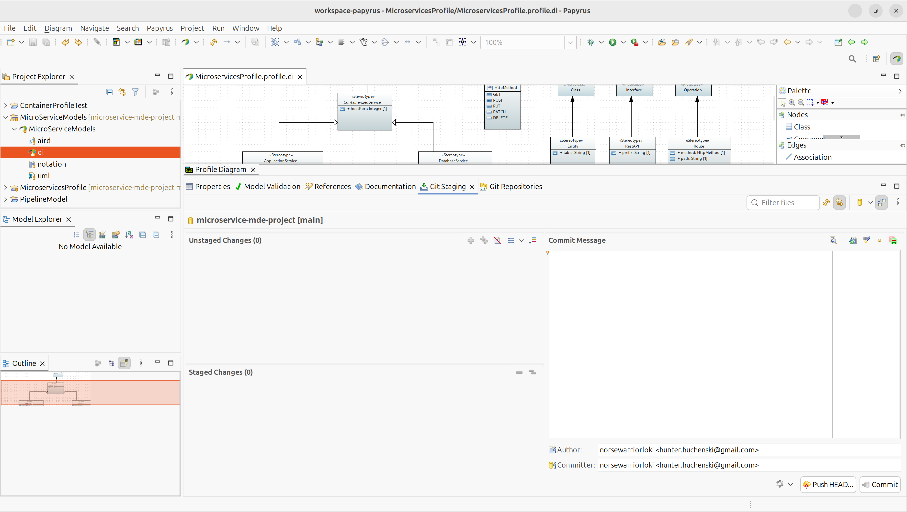
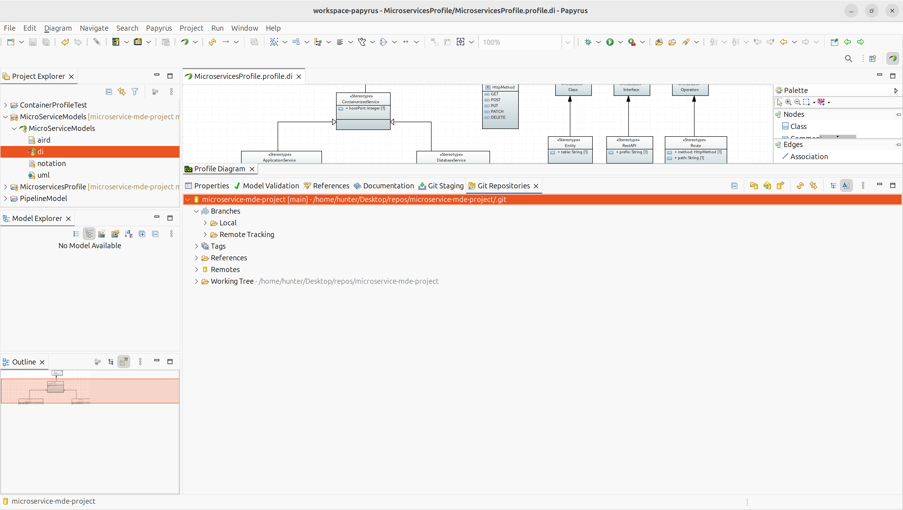
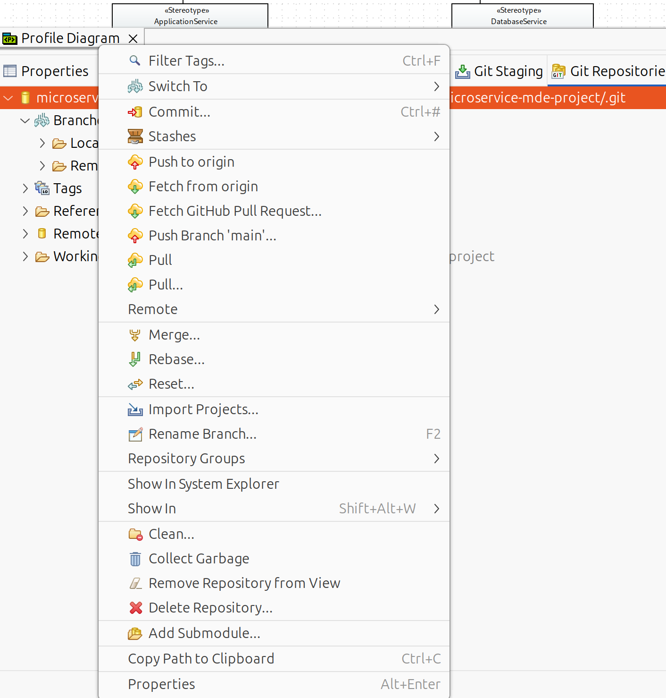

## How to Import this Repo into Papyrus
1. Open Eclipse Papyrus.
2. Select **File → Import… → Git → Projects from Git**, then **Next**.
3. Choose **Clone URI**, then **Next**.
4. Paste the repository URL into the **URI** field:

   ```text
   https://github.com/Xlin123/microservice-mde-project.git
   ```

   The host (`github.com`) and repository path should populate automatically.
5. Authenticate if prompted. For HTTPS access to a private repository, use your GitHub username and a **personal access token** instead of your GitHub account password. The token must have access to this repository.
6. Choose the **main** branch (or leave the offered branches selected) and select a local destination directory. **Do not use an existing Eclipse project folder** as the clone destination.
7. Complete the clone wizard. If it offers to import projects, choose **Import existing Eclipse projects** (sometimes shown as **Import Existing Projects**).
8. Select **both** `MicroservicesProfile` and `MicroServiceModels` when they are found, and finish the wizard. Do not create new projects with these names.
9. If the clone wizard finishes without offering project import, use **File → Import… → Git → Projects from Git → Existing local repository**, select the cloned repository, and choose **Import existing Eclipse projects**.

**Expected result in Project Explorer:**

```text
MicroservicesProfile
MicroServiceModels
```

They should be separate top-level Eclipse projects, even though both belong to the same Git repository.

## How to commit changes in Papyrus

1. Select Window → Show View → Other → Git → Git Staging

2. Double crosses in the unstaged changes area are for adding all files.

3. Add a commit message and push to the current branch.



## Branch/Repository Management

1. Select Window → Show View → Other → Git → Git Repositories. This opens a view that allows you to manage the repository

2. Right click on the root of the repo and there will be options for switching to a new branch and pulling from origin along with other options.







